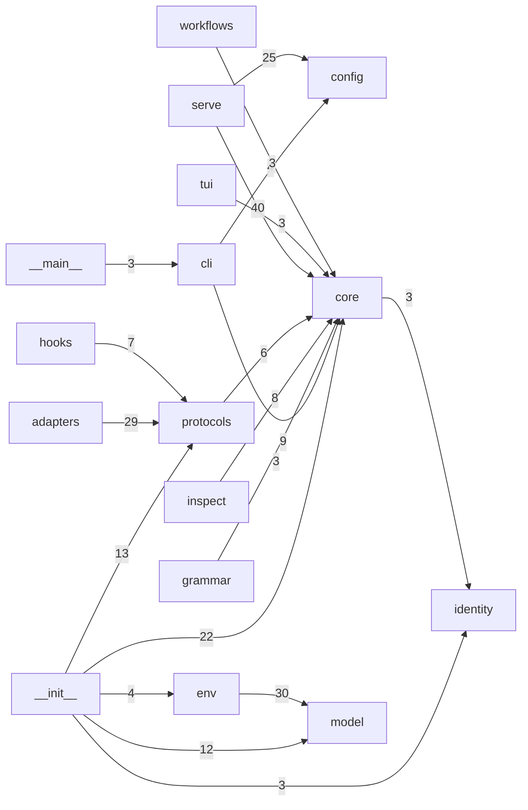

# Cantus 程式碼知識圖譜剖析（CodeGraph）

> 由 [CodeGraph](https://github.com/colbymchenry/codegraph) `1.6.2` 建立索引，
> 索引對應 commit `99f738b`。
> 再以 `scripts/codegraph_report.py` 從 `.codegraph/codegraph.db` 萃取成本文件與
> [`codegraph-summary.json`](codegraph-summary.json)。資料庫本身是機器本地檔、不進版控；
> 本頁與 JSON 是可 diff 的快照，重跑步驟見文末〈重現方式〉。

## 1. 總覽

- 索引檔案：**290**（語言：python 217、yaml 68、javascript 4、typescript 1）
- 依頂層目錄：`tests` 133、`cantus` 84、`openspec` 36、`.agents` 20、`.github` 6、`docs` 4、`scripts` 2、`regen-manifest.yaml` 1、`.wiki.manifest.yaml` 1、`.wiki-init.manifest.yaml` 1、`.spectra.yaml` 1、`.pre-commit-config.yaml` 1
- 節點 **3646**：function 1587、import 909、method 400、variable 263、class 240、file 222、constant 15、route 10
- 邊 **7885**：contains 3414、calls 1705、imports 977、instantiates 931、references 724、decorates 91、extends 43

## 2. 套件層級依賴圖（`cantus/*`）

把跨檔的 calls／instantiates／references／extends／imports／decorates 邊折疊到子套件層級；
箭頭 A → B 代表「A 依賴 B」，標籤是折疊進來的邊數。只畫權重 ≥ 3 的邊以免過密，完整清單在 JSON。



| 模組 | Fan-in（被幾個模組依賴） | Fan-out（依賴幾個模組） |
| --- | ---: | ---: |
| `cantus/core` | 11 | 1 |
| `cantus/model` | 3 | 2 |
| `cantus/protocols` | 3 | 1 |
| `cantus/config` | 2 | 0 |
| `cantus/env` | 2 | 1 |
| `cantus/identity` | 2 | 0 |
| `cantus/inspect` | 2 | 1 |
| `cantus/adapters` | 1 | 3 |
| `cantus/cli` | 1 | 4 |
| `cantus/serve` | 1 | 4 |
| `cantus/tui` | 1 | 1 |
| `cantus/__init__` | 0 | 6 |
| `cantus/__main__` | 0 | 1 |
| `cantus/grammar` | 0 | 1 |
| `cantus/hooks` | 0 | 2 |
| `cantus/workflows` | 0 | 1 |

### 模組間循環依賴

以下各組模組彼此（直接或間接）互相依賴（Tarjan SCC）。多半來自 lazy import 或型別參照，
不一定是錯，但代表這些模組無法各自獨立抽換：

- `cantus/env` ⇄ `cantus/model`

## 3. 熱點符號

### 3.1 Fan-in 最高（最多不同符號使用它，改動影響面最大）

| # | 符號 | 種類 | 位置 | 使用者數 | 來自 `cantus/` | 來自 `tests/` |
| ---: | --- | --- | --- | ---: | ---: | ---: |
| 1 | `skill` | function | [cantus/protocols/skill.py:80](../../cantus/protocols/skill.py#L80) | 82 | 2 | 80 |
| 2 | `Message` | class | [cantus/model/chat.py:39](../../cantus/model/chat.py#L39) | 73 | 5 | 68 |
| 3 | `serve` | function | [cantus/serve/app.py:74](../../cantus/serve/app.py#L74) | 58 | 1 | 57 |
| 4 | `Registry` | class | [cantus/core/registry.py:21](../../cantus/core/registry.py#L21) | 50 | 3 | 47 |
| 5 | `Settings` | class | [cantus/config.py:48](../../cantus/config.py#L48) | 46 | 6 | 40 |
| 6 | `Agent` | class | [cantus/core/agent.py:76](../../cantus/core/agent.py#L76) | 27 | 0 | 27 |
| 7 | `load_chat_model` | function | [cantus/model/factory.py:56](../../cantus/model/factory.py#L56) | 25 | 0 | 25 |
| 8 | `Skill` | class | [cantus/protocols/skill.py:35](../../cantus/protocols/skill.py#L35) | 24 | 7 | 17 |
| 9 | `Registry::register` | method | [cantus/core/registry.py:29](../../cantus/core/registry.py#L29) | 22 | 0 | 22 |
| 10 | `Agent::run` | method | [cantus/core/agent.py:97](../../cantus/core/agent.py#L97) | 21 | 0 | 21 |
| 11 | `get_registry` | function | [cantus/core/registry.py:81](../../cantus/core/registry.py#L81) | 20 | 4 | 16 |
| 12 | `OpenAIChatModel` | class | [cantus/model/providers/openai.py:25](../../cantus/model/providers/openai.py#L25) | 19 | 3 | 16 |
| 13 | `Result::success` | method | [cantus/core/result.py:23](../../cantus/core/result.py#L23) | 19 | 0 | 19 |
| 14 | `Turn` | class | [cantus/protocols/memory.py:31](../../cantus/protocols/memory.py#L31) | 18 | 3 | 15 |
| 15 | `Registry::names_for` | method | [cantus/core/registry.py:51](../../cantus/core/registry.py#L51) | 17 | 8 | 9 |
| 16 | `main` | function | [cantus/cli.py:342](../../cantus/cli.py#L342) | 17 | 1 | 16 |
| 17 | `GoogleChatPubSubChannel` | class | [cantus/serve/channels/googlechat.py:88](../../cantus/serve/channels/googlechat.py#L88) | 16 | 0 | 16 |
| 18 | `export_as_mcp_server` | function | [cantus/adapters/mcp_server.py:117](../../cantus/adapters/mcp_server.py#L117) | 16 | 10 | 6 |
| 19 | `_IntrospectionClient::aclose` | method | [cantus/tui/app.py:42](../../cantus/tui/app.py#L42) | 15 | 0 | 15 |
| 20 | `register_skill` | function | [cantus/protocols/skill.py:97](../../cantus/protocols/skill.py#L97) | 15 | 0 | 15 |

### 3.2 Fan-out 最高（依賴最多不同符號，最可能是協調者／複雜度集中處）

| # | 符號 | 種類 | 位置 | 依賴數 |
| ---: | --- | --- | --- | ---: |
| 1 | `serve` | function | [cantus/serve/app.py:74](../../cantus/serve/app.py#L74) | 19 |
| 2 | `CantusTUI::on_mount` | method | [cantus/tui/app.py:105](../../cantus/tui/app.py#L105) | 11 |
| 3 | `Agent::run` | method | [cantus/core/agent.py:97](../../cantus/core/agent.py#L97) | 8 |
| 4 | `GatewayClient::_run_one_session` | method | [cantus/serve/channels/_realtime.py:208](../../cantus/serve/channels/_realtime.py#L208) | 8 |
| 5 | `CantusTUI::compose` | method | [cantus/tui/app.py:83](../../cantus/tui/app.py#L83) | 7 |
| 6 | `_register_skill_endpoint::endpoint` | function | [cantus/serve/app.py:237](../../cantus/serve/app.py#L237) | 7 |
| 7 | `Agent::_dispatch_skill` | method | [cantus/core/agent.py:343](../../cantus/core/agent.py#L343) | 6 |
| 8 | `ColabEnvironment::prepare_model` | method | [cantus/env/colab.py:32](../../cantus/env/colab.py#L32) | 6 |
| 9 | `TelegramWebhookChannel::__init__` | method | [cantus/serve/channels/telegram.py:49](../../cantus/serve/channels/telegram.py#L49) | 6 |
| 10 | `_cmd_serve` | function | [cantus/cli.py:262](../../cantus/cli.py#L262) | 6 |
| 11 | `expose_as_dspy_tool` | function | [cantus/adapters/dspy.py:61](../../cantus/adapters/dspy.py#L61) | 6 |
| 12 | `expose_as_hf_tool` | function | [cantus/adapters/huggingface.py:118](../../cantus/adapters/huggingface.py#L118) | 6 |
| 13 | `register_introspection_routes::introspection_rollup` | function | [cantus/serve/introspection.py:483](../../cantus/serve/introspection.py#L483) | 6 |
| 14 | `Agent::_parse_action` | method | [cantus/core/agent.py:201](../../cantus/core/agent.py#L201) | 5 |
| 15 | `GoogleChatPubSubChannel::connect` | method | [cantus/serve/channels/googlechat.py:215](../../cantus/serve/channels/googlechat.py#L215) | 5 |
| 16 | `MLXChatModel::chat` | method | [cantus/model/providers/mlx.py:73](../../cantus/model/providers/mlx.py#L73) | 5 |
| 17 | `_from_function` | function | [cantus/protocols/skill.py:119](../../cantus/protocols/skill.py#L119) | 5 |
| 18 | `_parse` | function | [cantus/identity/soul.py:104](../../cantus/identity/soul.py#L104) | 5 |
| 19 | `from_anthropic_response` | function | [cantus/model/providers/_translate.py:168](../../cantus/model/providers/_translate.py#L168) | 5 |
| 20 | `from_google_response` | function | [cantus/model/providers/_translate.py:270](../../cantus/model/providers/_translate.py#L270) | 5 |

## 4. 體積最大的檔案（以 function／method／class 數計）

| 檔案 | 符號數 | 約略行數 |
| --- | ---: | ---: |
| [cantus/serve/introspection.py](../../cantus/serve/introspection.py) | 36 | 491 |
| [cantus/tui/widgets.py](../../cantus/tui/widgets.py) | 31 | 325 |
| [cantus/serve/channels/_googlechat_internals.py](../../cantus/serve/channels/_googlechat_internals.py) | 20 | 235 |
| [cantus/tui/app.py](../../cantus/tui/app.py) | 19 | 194 |
| [cantus/protocols/memory.py](../../cantus/protocols/memory.py) | 19 | 171 |
| [cantus/serve/channel.py](../../cantus/serve/channel.py) | 15 | 133 |
| [cantus/serve/channels/_realtime.py](../../cantus/serve/channels/_realtime.py) | 13 | 417 |
| [cantus/protocols/memory_auto.py](../../cantus/protocols/memory_auto.py) | 13 | 151 |
| [cantus/protocols/skill.py](../../cantus/protocols/skill.py) | 12 | 138 |
| [cantus/protocols/validator.py](../../cantus/protocols/validator.py) | 11 | 114 |
| [cantus/core/agent.py](../../cantus/core/agent.py) | 11 | 420 |
| [cantus/adapters/dspy.py](../../cantus/adapters/dspy.py) | 11 | 146 |
| [cantus/tui/client.py](../../cantus/tui/client.py) | 10 | 121 |
| [cantus/serve/channels/googlechat.py](../../cantus/serve/channels/googlechat.py) | 10 | 380 |
| [cantus/model/loader.py](../../cantus/model/loader.py) | 10 | 151 |

## 5. HTTP 路由

| 路由 | 位置 |
| --- | --- |
| `GET /skills` | [cantus/serve/dashboard.py:55](../../cantus/serve/dashboard.py#L55) |
| `GET /health` | [cantus/serve/dashboard.py:64](../../cantus/serve/dashboard.py#L64) |
| `GET /events` | [cantus/serve/dashboard.py:73](../../cantus/serve/dashboard.py#L73) |
| `GET /introspection/skills` | [cantus/serve/introspection.py:415](../../cantus/serve/introspection.py#L415) |
| `GET /introspection/sessions` | [cantus/serve/introspection.py:424](../../cantus/serve/introspection.py#L424) |
| `GET /introspection/permissions` | [cantus/serve/introspection.py:434](../../cantus/serve/introspection.py#L434) |
| `GET /introspection/queues` | [cantus/serve/introspection.py:443](../../cantus/serve/introspection.py#L443) |
| `GET /introspection/workflows/{run_id}` | [cantus/serve/introspection.py:452](../../cantus/serve/introspection.py#L452) |
| `GET /introspection/dataflow` | [cantus/serve/introspection.py:468](../../cantus/serve/introspection.py#L468) |
| `GET /introspection` | [cantus/serve/introspection.py:477](../../cantus/serve/introspection.py#L477) |

## 6. 類別繼承（`cantus/` 內）

- `Action` ← `CallSkillAction`、`FinalAnswerAction`
- `Channel` ← `RealtimeChannel`、`WebhookChannel`
- `Memory` ← `BM25Memory`、`EmbeddingMemory`、`MarkdownMemory`、`ShortTermMemory`
- `Observation` ← `MaxIterationsObservation`、`SkillObservation`、`ToolErrorObservation`、`ValidationErrorObservation`
- `OpenAIChatModel` ← `NvidiaChatModel`、`OllamaChatModel`、`OmlxChatModel`
- `Skill` ← `_MemoryTool`、`_RemoteSkillBase`
- `_MemoryTool` ← `_CreateTool`、`_DeleteTool`、`_StrReplaceTool`、`_ViewTool`
- `_RemoteSkillBase` ← `_DspyRemoteSkill`、`_HuggingFaceRemoteSkill`、`_LangChainRemoteSkill`、`_RemoteSkill`

## 7. 待人工確認的清單

以下兩份清單是**靜態圖譜的推論**，Python 的動態屬性存取、`__getattr__` lazy export、
decorator 註冊、entry point 與字串式 import 都看不到，因此只是「值得看一眼」而非結論。

### 7.1 未被任何已索引程式碼參照的公開 function／class（13 個）

<details><summary>展開清單</summary>

- `export_as_mcp_server`（function）— [cantus/adapters/__init__.py:49](../../cantus/adapters/__init__.py#L49)
- `import_mcp_server`（function）— [cantus/adapters/__init__.py:56](../../cantus/adapters/__init__.py#L56)
- `expose_as_langchain_tool`（function）— [cantus/adapters/__init__.py:72](../../cantus/adapters/__init__.py#L72)
- `import_langchain_tool`（function）— [cantus/adapters/__init__.py:79](../../cantus/adapters/__init__.py#L79)
- `expose_as_dspy_tool`（function）— [cantus/adapters/__init__.py:86](../../cantus/adapters/__init__.py#L86)
- `import_dspy_tool`（function）— [cantus/adapters/__init__.py:93](../../cantus/adapters/__init__.py#L93)
- `expose_as_hf_tool`（function）— [cantus/adapters/__init__.py:100](../../cantus/adapters/__init__.py#L100)
- `import_hf_tool`（function）— [cantus/adapters/__init__.py:111](../../cantus/adapters/__init__.py#L111)
- `expose_as_openhands_action`（function）— [cantus/adapters/__init__.py:123](../../cantus/adapters/__init__.py#L123)
- `expose_as_anthropic_memory_tool`（function）— [cantus/adapters/anthropic_memory.py:69](../../cantus/adapters/anthropic_memory.py#L69)
- `ModelHandle`（class）— [cantus/core/agent.py:54](../../cantus/core/agent.py#L54)
- `MLXChatModel`（class）— [cantus/model/providers/mlx.py:40](../../cantus/model/providers/mlx.py#L40)
- `Opcode`（class）— [cantus/serve/channels/_realtime.py:38](../../cantus/serve/channels/_realtime.py#L38)

</details>

### 7.2 沒有任何 `tests/` 符號直接連到的 `cantus/` 檔案（5 個，已排除 `__init__.py`）

這不等於沒有測試覆蓋（可能經由其他模組間接覆蓋），而是「沒有測試直接 import／呼叫其中符號」。

- [cantus/__main__.py](../../cantus/__main__.py)
- [cantus/adapters/anthropic_memory.py](../../cantus/adapters/anthropic_memory.py)
- [cantus/adapters/mcp.py](../../cantus/adapters/mcp.py)
- [cantus/model/providers/mlx.py](../../cantus/model/providers/mlx.py)
- [cantus/protocols/_common.py](../../cantus/protocols/_common.py)

## 重現方式

```bash
# 1. 建立／重建索引（DO_NOT_TRACK=1 關閉 CodeGraph 匿名 telemetry）
DO_NOT_TRACK=1 npx -y @colbymchenry/codegraph@1.6.2 init -y .
# 2. 產生本頁與 codegraph-summary.json
python scripts/codegraph_report.py
```

`.codegraph/` 會自帶一份 `.gitignore`（忽略資料庫、pid、log），不需要也不應該 commit。
索引建好後也可直接用 CLI 互動查詢，例如 `codegraph impact Agent`、`codegraph callers load_chat_model`。
